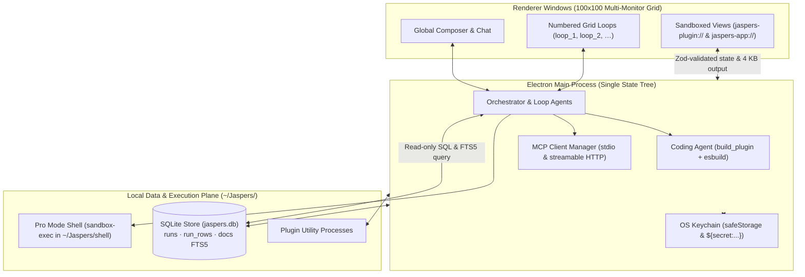

<p align="center">
  
</p>

<h1 align="center">Jaspers Terminal</h1>

<p align="center">
  The open-source agentic terminal for public markets — built for open and local inference.
</p>

<p align="center">
  <a href="LICENSE"></a>
  <a href="https://www.npmjs.com/package/@jaspers-ai/sdk"></a>
  
  
</p>

---

**Jaspers Terminal** is a persistent, local-first desktop runtime and spreadsheet grid for public-market research, engineered to free analysts, quants, and traders from closed, paid cloud models. Download Jaspers Terminal for macOS and Windows at [jsprai.com/terminal](https://jsprai.com/terminal).

General-purpose chat harnesses cram market feeds, filing prose, and tool payloads into a single conversation thread. Only the largest, most expensive frontier cloud models survive that context bloat — local and open-weight models quickly overflow their context windows, hallucinate tool arguments, and lose track of workspace state.

Jaspers Terminal solves this at the harness level so **local and open-weight models run reliably**:

- **Context offloading to local SQLite (`~/Jaspers/data/jaspers.db`):** Raw tool payloads, time series, and SEC filing text never flood the prompt. Every source call is indexed locally into `runs`, `run_rows`, and an external-content FTS5 search index (`docs`), while the model queries compact slices via SQL (`query`) and reads bounded 4 KB view outputs.
- **Compact Zod contracts & isolated Grid Loops:** Every tile on the 100 × 100 multi-monitor grid is an independent, numbered subagent loop (`loop_1`, `loop_2`, …) with its own scoped tools, conversation thread, and strict Zod `state` and `output` schemas.
- **Self-repairing coding agent (`build_plugin`):** When no installed plugin provides the data or visualization you ask for, a dedicated builder loop synthesizes a TypeScript plugin from test-verified templates, checks its own types and esbuild bundles, and verifies live calls before placing the view on the grid.

<!-- Screenshot: replace with a capture of a workspace once one is ready.
<p align="center">
  
</p>
-->

## The 7 Core Advantages

### 1. Built-in Coding Agent (`build_plugin`)

Ask for the data or visualization you need, not the plugin: *"chart the 10-year Treasury yield from FRED"*, *"make a PDF memo of this valuation"*, or *"connect me to my firm's research server"*. The assistant searches [Jaspers Hub](https://hub.jsprai.com) first and offers to install a matching plugin if one exists. When nothing on Hub fits, it delegates to its built-in coding agent (`build_plugin`), a dedicated model loop with the [SDK reference](docs/sdk-reference.md) and four [starter templates](docs/templates/README.md) in its prompt.

Before any plugin code runs, one prompt shows the plugin's security **envelope** — every host it may reach, every secret key it may ask for, every capability, MCP connection, and npm package it declares — and saves your approval to `.jaspers-build.json`. The builder then compiles the plugin with esbuild, repairs its own TypeScript and bundler diagnostics (`check_plugin`), tests each source with a real call (`run_source`), and places the finished view on your grid. See [Asking the assistant for a plugin](docs/asking-for-a-plugin.md).

### 2. Open Plugin Library & MCP-Native Data Plane

Jaspers Terminal uses open standards instead of proprietary connectors. Every data source is either a [Model Context Protocol (MCP)](https://modelcontextprotocol.io) server (over stdio or streamable HTTP) or a TypeScript function source.

- **Built-in views for any source:** Sortable **Table**, **Chart** (line, area, bar, horizontal bar, scatter, pie, candlestick, heatmap), and **Metric** views render any source or SQL query out of the box without custom UI code.
- **MCP Apps (`ui://`):** Servers that ship their own interactive HTML views have them rendered directly inside sandboxed grid tiles (`jaspers-app://`).
- **Verifiable citations:** Sources that return structured `citations` let the assistant cite exact passages (`[^id]`) with the source's own quote and link.
- **Jaspers Hub:** Discover, install, and publish reviewed plugins and skills at [hub.jsprai.com](https://hub.jsprai.com). Jaspers' own paid data offerings — **Jaspers Discover** (`jaspers/screener-mcp`) and **Jaspers Research** (`jaspers/research`) — use the exact same public plugin API as community plugins. See [Connections and data](docs/connections-and-data.md) and [Installing plugins](docs/installing-plugins.md).

### 3. TypeScript End-to-End (`@jaspers-ai/sdk`)

Plugins are authored in strict TypeScript against `@jaspers-ai/sdk` ([MIT](packages/sdk/LICENSE)): `definePlugin`, `defineConnection`, `defineSource`, and `defineView`, paired with React hooks (`usePanelState`, `useData`, `usePublish`, `usePublishText`).

The Terminal provides React, React DOM, Zod, and `@jaspers-ai/sdk` at runtime through its zero-install host runtime (`jaspers-host://runtime/`), so a plugin folder in `~/Jaspers/plugins/<id>` needs no `node_modules` unless it imports third-party packages. Saving any file in `~/Jaspers/plugins/<id>` triggers an esbuild rebuild in milliseconds and hot-reloads the view in place without losing panel state. Because the same documentation ([`docs/sdk-reference.md`](docs/sdk-reference.md) and [`docs/writing-a-plugin.md`](docs/writing-a-plugin.md)) is embedded verbatim via `?raw` into the coding agent's system prompt, human developers and the coding agent target the exact same contracts.

### 4. Open Source & Local-First

The entire Terminal codebase is open source under the [Business Source License 1.1](LICENSE) (converting automatically to MIT four years after each release) and is complete without a Jaspers subscription.

Everything the Terminal fetches is stored in one SQLite file on your machine, `~/Jaspers/data/jaspers.db`, stamped with the source, arguments, workspace, and timestamp. Nothing expires and nothing leaves your machine. Open `~/Jaspers/data/jaspers.db` directly in `sqlite3`, DuckDB, R, or Python/pandas while Jaspers Terminal is running.

### 5. Own Your Inference

Run the Terminal entirely on local or open-weight models with zero cloud lock-in:

- **Local inference engines:** First-class support for **Ollama** (`http://localhost:11434/v1`, default `llama3.2`, no API key required) and any **Custom** OpenAI-compatible server including **vLLM**, **llama.cpp** (`llama-server`), and **LM Studio**.
- **Open-weight & cloud routers:** Run open-weight models at high speed through **OpenRouter** (`https://openrouter.ai/api/v1`) and **Groq** (`https://api.groq.com/openai/v1`), or connect direct keys for **Anthropic**, **Amazon Bedrock**, **OpenAI**, **Google Gemini**, and **xAI**, or sign in with **Jaspers** (Jaspers One) for one-step models, voice, and web search.
- **Portable conversation threads (`portable`):** Switch providers, base URLs, or models mid-session in **Settings > Language model**. Workspace and loop threads automatically strip provider-specific replay payloads (such as thinking blocks) while preserving every message and tool call, so a local model picks up right where a cloud model left off.
- **Per-task model pinning:** Pin a smaller or local model to recurring background tasks while keeping a larger model for interactive analysis.

### 6. Own Your Workflows

Turn ad-hoc research into repeatable, automated market workflows:

- **Agent Skills (`SKILL.md`):** Package domain playbooks (DCF layouts, morning briefs, earnings reviews, credit checklists) in the open [Agent Skills](https://agentskills.io) format under `~/Jaspers/skills/<name>/SKILL.md` or inside a plugin's `skills/` directory. Invoke them with `/name` or let the assistant load them automatically when a request matches.
- **NYSE market-calendar scheduling:** Schedule recurring prompts or direct source refreshes ("every weekday at 9:35am ET when the market is open") backed by built-in NYSE trading-day and holiday rules.
- **Zero-token SQLite delta watches:** Configure tasks with a direct `call` and `speak: "changed"` so the Terminal polls the data source and compares rows in SQLite on schedule, waking the language model **only** when the underlying data actually changes. See [Skills](docs/skills.md).

### 7. Shell Access for Full Control in Pro Mode

When enabled in **Settings > Pro mode**, the assistant can execute local multi-line shell, Python, R, and CLI scripts inside `~/Jaspers/shell`, with read-only access to `~/Desktop` and `~/Downloads`.

- **Explicit approval tiers:** Review every script in full before execution, with allowances for **Allow once**, **Allow in this conversation** (exact script match), **Allow every command in this conversation**, or pre-approved scripts attached to a scheduled task (**Allow for this task**).
- **Deterministic read-only filter:** Optionally allow single-command read-only inspections (`ls`, `cat`, `head`, `grep`, `wc`, `find`, `git status`, `git log`, …) with no pipes, redirects, or command substitution to run without prompting.
- **Kernel-enforced macOS sandbox & audit log:** Commands run under macOS `sandbox-exec` with a sanitized environment (`commandEnv` strips app credentials) and cannot read `~/.ssh`, other `/Users` directories, or write outside `~/Jaspers/shell`. Every request is audited in `~/Jaspers/data/shell.jsonl`, and [Eye](docs/eye.md) skips screen capture whenever a Pro Mode approval prompt is visible. See [Pro mode](docs/pro-mode.md).

## Architecture



- **Shared SQLite data plane (`~/Jaspers/data/jaspers.db`):** Runs in a dedicated store process so synchronous SQLite queries never block UI state pushes. `runs` records every source invocation; `run_rows` stores normalized JSON rows (`json_extract(data, '$.field')`); `docs` provides an external-content FTS5 full-text index over filing and transcript prose.
- **MCP-native data plane:** Connections declared in `plugin.tsx` or added in **Settings > Connections** connect over stdio or streamable HTTP. Two identical source runs within 60 seconds share one in-flight call.
- **Sandbox & OS keychain security:** API keys and OAuth tokens are encrypted via the OS keychain (`safeStorage`) and injected only inside the main process via `${secret:<name>}` placeholders. Plugin definitions are evaluated in a zero-privilege `vm` context (no filesystem, no network, 2-second timeout); views run in network-isolated `jaspers-plugin://` iframes; MCP Apps run in per-connection `jaspers-app://` iframes governed by their declared CSP. See [How it works](docs/architecture.md).

## Quick start

Download prebuilt releases for **macOS (Apple Silicon)** and **Windows** at [jsprai.com/terminal](https://jsprai.com/terminal), or run from source with [Node 24](.nvmrc) (`nvm use`):

```sh
git clone https://github.com/JaspersAI/terminal.git
cd terminal
npm install
npm run dev
```

### Option A: Local & Open-Weight LLMs (Recommended for Open Inference)

1. **Ollama (local, zero API keys):**
   ```sh
   ollama pull llama3.2
   ollama serve
   ```
   On first launch (or in **Settings > Language model**), choose **Other providers > Ollama**. The default base URL (`http://localhost:11434/v1`) and model (`llama3.2`) are pre-filled; replace the model name with any tag you pulled (such as `qwen2.5-coder:32b` or `deepseek-r1:32b`).
2. **vLLM, llama.cpp (`llama-server`), or LM Studio:**
   Choose **Other providers > Custom**, enter your local OpenAI-compatible base URL (for example `http://localhost:8000/v1` for vLLM, `http://localhost:8080/v1` for `llama.cpp`, or `http://localhost:1234/v1` for LM Studio) and model identifier. No API key is required unless your server enforces one.
3. **Hosted open-weight providers:**
   Choose **OpenRouter** (`https://openrouter.ai/api/v1`) or **Groq** (`https://api.groq.com/openai/v1`, default `llama-3.3-70b-versatile`) and paste your key, which is sealed in your OS keychain.

### Option B: Jaspers One or Cloud Providers

- **Sign in with Jaspers (Jaspers One):** One browser sign-in configures the language model (`anthropic/claude-opus-5.5`), voice transcription (`openai/gpt-4o-mini-transcribe`), and web search at once, and automatically installs the official **Jaspers Screener** (`jaspers/screener-mcp`) and **Jaspers Research** (`jaspers/research`) plugins from [Jaspers Hub](https://hub.jsprai.com).
- **Direct cloud keys:** Choose **Anthropic** (`claude-opus-5`), **Amazon Bedrock** (`https://bedrock-mantle.<region>.api.aws/anthropic`, default `anthropic.claude-opus-4-8`), **OpenAI** (`gpt-5.4`), **Google** (`gemini-3.8-flash`), or **xAI** (`grok-4.6`), plus optional voice (**ElevenLabs**, **OpenAI**, **Deepgram**, **Cartesia**, or **Custom**) and web search (**Brave Search** or **Amazon Bedrock**).

See [Getting started](docs/getting-started.md) for detailed local model tuning, workspace model switching, per-task model pinning, multi-monitor setup, and [packaging](docs/getting-started.md#packaging).

## 30-second plugin overview

A plugin is a folder in `~/Jaspers/plugins/<id>/` with a `plugin.tsx`. The app supplies `react`, `react-dom`, `zod`, and `@jaspers-ai/sdk` at runtime and hot-reloads on save:

```tsx
import { definePlugin, defineSource, defineView, useData, usePublish, type PanelRef } from "@jaspers-ai/sdk";
import { z } from "zod";

const treasuryYield = defineSource({
  description: "Latest US Treasury constant-maturity yields by tenor.",
  input: z.object({ tenor: z.enum(["2Y", "10Y", "30Y"]).default("10Y") }),
  run: async ({ tenor }) => [
    { date: "2026-10-20", tenor, yieldPct: tenor === "10Y" ? 4.18 : 4.02 },
  ],
});

function YieldTile({ panel }: { panel: PanelRef }) {
  const { data } = useData("rates/treasuryYield", { tenor: "10Y" });
  const rows = (data ?? []) as { date: string; tenor: string; yieldPct: number }[];
  usePublish(panel, { latest: rows[0]?.yieldPct ?? null });
  return <div>10Y Yield: {rows[0]?.yieldPct ?? "…"}%</div>;
}

export default definePlugin({
  id: "rates",
  sources: { treasuryYield },
  views: {
    tile: defineView(YieldTile, {
      title: "Treasury Yield",
      state: z.object({}),
      output: z.object({ latest: z.number().nullable() }),
      renders: [treasuryYield],
    }),
  },
});
```

See [Writing a plugin](docs/writing-a-plugin.md), the [SDK reference](docs/sdk-reference.md), and the four test-verified starter templates in [`docs/templates/`](docs/templates/README.md).

## Plugins on Jaspers Hub

[Jaspers Hub](https://hub.jsprai.com) is where plugins and skills are discovered, reviewed, and shared. The Terminal ships with no bundled plugins: its directory during setup and in **Settings > Plugins** lists Hub's featured plugins first, then community plugins ordered by stars. The assistant searches the same directory before invoking the coding agent.

Jaspers' own market data takes no private path: **Jaspers Discover** (`jaspers/screener-mcp`) and **Jaspers Research** (`jaspers/research`), along with ~30 official free and vendor plugins (`plugin-tradingview`, `plugin-fmp`, `plugin-earningscall`, `plugin-yfinance`, `plugin-markdown`, and more), are published on Hub as `jaspers` and live in public repositories under [github.com/JaspersAI](https://github.com/JaspersAI). Publish your own hand-written or agent-built plugins and skills from **Settings > Plugins** or **Settings > Skills**; every version is reviewed before listing. See [Publishing a plugin](docs/publishing-a-plugin.md).

## Documentation

Browse the full [documentation index](docs/README.md):

| Guide | What it covers |
| --- | --- |
| [Documentation index](docs/README.md) | Overview of all user, plugin, workflow, and contributor guides |
| [Getting started](docs/getting-started.md) | Local LLM setup (Ollama, vLLM, llama.cpp, LM Studio), cloud providers, model pinning, commands, packaging |
| [How it works](docs/architecture.md) | Open-inference reliability, SQLite context offloading, `build_plugin` lifecycle, concurrent Grid Loops, project layout |
| [Asking the assistant for a plugin](docs/asking-for-a-plugin.md) | The built-in coding agent, the security envelope prompt (`.jaspers-build.json`), and self-repairing builds |
| [Writing a plugin](docs/writing-a-plugin.md) | Build a full MCP + React watchlist plugin from scratch with `@jaspers-ai/sdk` |
| [SDK reference](docs/sdk-reference.md) | `definePlugin`, `defineSource`, `defineView`, `ctx` capabilities, hooks, connections, and secrets |
| [Plugin templates](docs/templates/README.md) | Four copyable starter plugins (`feed`, `feed-table`, `document`, `connection`) verified by the test suite |
| [Installing plugins](docs/installing-plugins.md) | Installing from [Jaspers Hub](https://hub.jsprai.com), GitHub releases, links, or archives |
| [Skills & workflows](docs/skills.md) | Agent Skills (`SKILL.md`), NYSE market-calendar scheduled tasks, and zero-token SQLite delta watches |
| [Connections and data](docs/connections-and-data.md) | Adding MCP servers, built-in Table/Chart/Metric views, MCP Apps, citations, and `~/Jaspers/data/jaspers.db` |
| [Publishing a plugin](docs/publishing-a-plugin.md) | Publishing plugins and skills to Jaspers Hub from Settings or via GitHub releases |
| [Pro mode](docs/pro-mode.md) | Sandboxed shell, Python, R, and CLI execution in `~/Jaspers/shell`, approval tiers, and `sandbox-exec` confinement |
| [Eye](docs/eye.md) | Opt-in live feedback sharing and one-shot feedback: what is captured, what is excluded, and local storage |
| [Development](docs/development.md) | Process boundaries, security invariants, testing, and release packaging |
| [Roadmap](docs/roadmap.md) | Live shipped capabilities and what comes next |

Contributor commands and architectural rules are in [CLAUDE.md](CLAUDE.md); agent instructions are in [AGENTS.md](AGENTS.md).

## License

| Component | Path | License | Notes |
| --- | --- | --- | --- |
| **Jaspers Terminal** | Root repository | [Business Source License 1.1](LICENSE) | Free to use at home or at work; forbids offering the Terminal or a fork as a hosted/managed product or service. Each version automatically converts to **MIT** four years after release. |
| **`@jaspers-ai/sdk`** | [`packages/sdk/`](packages/sdk/README.md) | [MIT](packages/sdk/LICENSE) | Permissive MIT license; plugins built with the SDK may use any license you choose. |
| **Plugin templates** | [`docs/templates/`](docs/templates/README.md) | [MIT](packages/sdk/LICENSE) | Free to copy, modify, and publish as your own plugins. |
