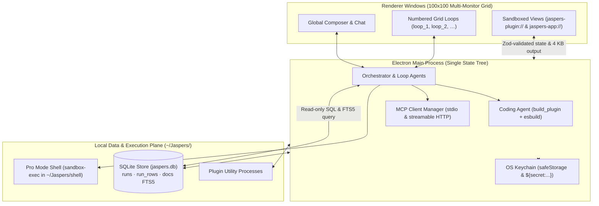

<p align="center">
  
</p>

<h1 align="center">Jaspers Terminal</h1>

<p align="center">
  Desktop terminal and spreadsheet grid for public-market research, source-available under BSL 1.1.
</p>

<p align="center">
  <a href="LICENSE"></a>
  <a href="https://www.npmjs.com/package/@jaspers-ai/sdk"></a>
  
  
</p>

---

**Jaspers Terminal** is an Electron desktop application and spreadsheet grid for public-market research on macOS and Windows. It connects local, open-weight, and cloud language models to MCP servers, TypeScript plugins, and a local SQLite store. Prebuilt installers are available at [jsprai.com/terminal](https://jsprai.com/terminal). It is a research tool, not investment advice: see [DISCLAIMER.md](DISCLAIMER.md) and the [Terms of Use](https://jsprai.com/terms).

To keep prompt sizes bounded across local, open-weight, and cloud models, the harness separates data storage, panel state, and per-tile execution from the main conversation thread:

- **Context offloading to local SQLite (`~/Jaspers/data/jaspers.db`):** Tool payloads, time series, and SEC filing text are stored outside the conversation prompt. Every source call is indexed locally into `runs`, `run_rows`, and an external-content FTS5 search index (`docs`), while the model queries slices via SQL (`query`) and reads bounded 4 KB view outputs.
- **Zod schema contracts and isolated Grid Loops:** Each tile on the 100 × 100 multi-monitor grid is an independent, numbered subagent loop (`loop_1`, `loop_2`, …) with scoped tools, its own conversation thread, and Zod `state` (2 KB max) and `output` (4 KB max) schemas.
- **Built-in coding agent (`build_plugin`):** When no installed plugin provides a requested data source or view, a builder loop writes a TypeScript plugin from starter templates, checks its types and esbuild bundles, and runs source calls before placing the view on the grid.

<!-- Screenshot: replace with a capture of a workspace once one is ready.
<p align="center">
  
</p>
-->

## The 7 Core Advantages

### 1. Built-in Coding Agent (`build_plugin`)

When a request requires a data source or view that is not installed (for example, *"chart the 10-year Treasury yield from FRED"*, *"make a PDF memo of this valuation"*, or *"connect me to my firm's research server"*), the assistant searches [Jaspers Hub](https://hub.jsprai.com) first and offers to install a matching plugin if one exists. When no matching plugin is found on Hub, it delegates to the built-in coding agent (`build_plugin`), a separate model loop loaded with the [SDK reference](docs/sdk-reference.md) and four [starter templates](docs/templates/README.md).

Before any plugin code runs, an approval prompt displays the plugin's security **envelope** — the hosts it may contact, secret keys it requests, capabilities, MCP connections, and npm packages — and records approval in `.jaspers-build.json`. The builder compiles the plugin with esbuild, checks TypeScript and bundler diagnostics (`check_plugin`), executes each source (`run_source`), and places the resulting view on the grid. See [Asking the assistant for a plugin](docs/asking-for-a-plugin.md).

### 2. MCP Connections & Plugin Data Plane

Every data source in Jaspers Terminal is either a [Model Context Protocol (MCP)](https://modelcontextprotocol.io) server (connected over stdio or streamable HTTP) or a TypeScript function source.

- **Built-in views:** Sortable **Table**, **Chart** (line, area, bar, horizontal bar, scatter, pie, candlestick, heatmap), and **Metric** views render any source or SQL query without a custom React component.
- **MCP Apps (`ui://`):** MCP servers that provide `text/html;profile=mcp-app` resources render inside sandboxed grid tiles on the `jaspers-app://` scheme.
- **Source citations:** Sources that return structured `citations` allow the assistant to reference passages (`[^id]`) with the source's quote and URL.
- **Jaspers Hub:** Plugins and skills are listed and reviewed at [hub.jsprai.com](https://hub.jsprai.com). Jaspers' hosted MCP plugins — **Jaspers Discover** (`jaspers/screener-mcp`) and **Jaspers Research** (`jaspers/research`) — use the same public plugin API as third-party plugins. See [Connections and data](docs/connections-and-data.md) and [Installing plugins](docs/installing-plugins.md).

### 3. TypeScript Runtime & SDK (`@jaspers-ai/sdk`)

Plugins are written in TypeScript using `@jaspers-ai/sdk` ([MIT](packages/sdk/LICENSE)): `definePlugin`, `defineConnection`, `defineSource`, and `defineView`, paired with React hooks (`usePanelState`, `useData`, `usePublish`, `usePublishText`, `useBridge`, `usePanel`).

The Terminal provides React, React DOM, Zod, and `@jaspers-ai/sdk` at runtime through its host runtime (`jaspers-host://runtime/`), so a plugin folder in `~/Jaspers/plugins/<id>` does not require `node_modules` unless it imports third-party packages. Saving a file in `~/Jaspers/plugins/<id>` triggers an esbuild rebuild and remounts the view while preserving panel state. The SDK documentation ([`docs/sdk-reference.md`](docs/sdk-reference.md) and [`docs/writing-a-plugin.md`](docs/writing-a-plugin.md)) is imported via `?raw` into the coding agent's system prompt so manual and agent-generated plugins use the same definitions.

### 4. Open Source Licensing (BSL 1.1 / MIT) & Local SQLite Storage

The Terminal repository is source-available under [BSL 1.1](LICENSE), which converts to MIT four years after each release, and `@jaspers-ai/sdk` in `packages/sdk/` is licensed under [MIT](packages/sdk/LICENSE). The application runs without requiring a Jaspers subscription.

Fetched source data is stored in a local SQLite database at `~/Jaspers/data/jaspers.db`, recorded with the source identifier, arguments, workspace, and timestamp. Records remain on disk by default; prompts and source requests are sent only to the model providers and MCP servers you configure. Stored runs have no automatic expiration, while task watch history retains the latest 20 observations per task (see [How it works](docs/architecture.md)). `~/Jaspers/data/jaspers.db` can be queried directly with `sqlite3`, DuckDB, R, or Python while Jaspers Terminal is running.

### 5. Inference Configuration (Local, Open-Weight, and Cloud Models)

Configure local servers, open-weight model routers, or cloud providers in **Settings > Language model**:

- **Local inference servers:** Connect to **Ollama** (`http://localhost:11434/v1`, default `llama3.2`, no API key required) or any **Custom** OpenAI-compatible server including **vLLM**, **llama.cpp** (`llama-server`), and **LM Studio**.
- **Model routers and cloud providers:** Connect **OpenRouter** (`https://openrouter.ai/api/v1`) and **Groq** (`https://api.groq.com/openai/v1`), connect API keys for **Anthropic**, **Amazon Bedrock**, **OpenAI**, **Google Gemini**, and **xAI**, or sign in with **Jaspers** (Jaspers One) to configure language models, voice transcription, and web search.
- **Portable conversation threads (`portable`):** Switching providers, base URLs, or models in **Settings > Language model** converts workspace and loop threads via `portable`, stripping provider-specific replay payloads (such as thinking blocks) while retaining user messages, assistant replies, and tool calls.
- **Per-task model pinning:** Assign a specific model identifier to individual scheduled tasks while keeping another model configured for interactive workspace requests.

### 6. Workflow Storage, Scheduling, and SQLite Delta Watches

Store reusable instructions and schedule recurring tasks on disk:

- **Agent Skills (`SKILL.md`):** Store workflow instructions (such as DCF layouts, morning briefs, earnings reviews, or credit checklists) in the [Agent Skills](https://agentskills.io) format under `~/Jaspers/skills/<name>/SKILL.md` or inside a plugin's `skills/` directory. Invoke them with `/name` or allow the assistant to load them when a request matches the skill's description.
- **NYSE market-calendar scheduling:** Schedule recurring prompts or direct source refreshes on fixed intervals or IANA time-zone clock rules ("every weekday at 9:35am ET when the market is open") backed by NYSE trading-day and holiday tables.
- **SQLite delta watches (`speak: "changed"`):** Configure tasks with a direct tool `call` and `speak: "changed"` so the Terminal polls the data source and compares rows in SQLite on schedule, invoking the language model only when rows are added or removed. See [Skills](docs/skills.md).

### 7. Sandboxed Shell Access in Pro Mode

When enabled in **Settings > Pro mode**, the assistant can execute local multi-line shell, Python, R, and CLI scripts inside `~/Jaspers/shell`, with read-only access to `~/Desktop` and `~/Downloads`.

- **Approval tiers:** Review each script before execution, with options for **Allow once**, **Allow in this conversation** (exact script match), **Allow every command in this conversation**, or pre-approved scripts attached to a scheduled task (**Allow for this task**).
- **Read-only command filter:** Optionally allow single-command read-only inspections (`ls`, `cat`, `head`, `grep`, `wc`, `find`, `git status`, `git log`, …) with no pipes, redirects, or command substitution to run without prompting.
- **macOS `sandbox-exec` confinement and audit log:** Commands run under macOS `sandbox-exec` with a sanitized environment (`commandEnv` strips application credentials) and cannot read `~/.ssh`, other `/Users` directories, or write outside `~/Jaspers/shell` and system temporary directories. Every request is logged in `~/Jaspers/data/shell.jsonl`, and [Eye](docs/eye.md) skips screen capture whenever a Pro Mode approval prompt is visible. See [Pro mode](docs/pro-mode.md).

## Architecture



- **Shared SQLite data plane (`~/Jaspers/data/jaspers.db`):** Runs in a dedicated store process so synchronous SQLite queries do not block UI state updates. `runs` records each source invocation; `run_rows` stores normalized JSON rows (`json_extract(data, '$.field')`); `docs` provides an external-content FTS5 full-text index over filing and transcript text.
- **MCP and function sources:** Connections declared in `plugin.tsx` or added in **Settings > Connections** connect over stdio or streamable HTTP. Two identical source runs within 60 seconds share one in-flight call.
- **Sandbox and OS keychain isolation:** API keys and OAuth tokens are encrypted via the OS keychain (`safeStorage`) and injected only inside the main process via `${secret:<name>}` placeholders. Plugin definitions are evaluated in a restricted `vm` context (no filesystem, no network, 2-second timeout); views run in network-isolated `jaspers-plugin://` iframes; MCP Apps run in per-connection `jaspers-app://` iframes governed by their declared CSP. See [How it works](docs/architecture.md).

## Quick start

Download prebuilt releases for **macOS (Apple Silicon)** and **Windows** at [jsprai.com/terminal](https://jsprai.com/terminal), or run from source with [Node 24](.nvmrc) (`nvm use`):

```sh
git clone https://github.com/JaspersAI/terminal.git
cd terminal
npm install
npm run dev
```

### Option A: Local and Open-Weight Models

1. **Ollama (local, no API key):**
   ```sh
   ollama pull llama3.2
   ollama serve
   ```
   On first launch (or in **Settings > Language model**), choose **Other providers > Ollama**. The default base URL (`http://localhost:11434/v1`) and model (`llama3.2`) are pre-filled; replace the model name with any tag you pulled (such as `qwen2.5-coder:32b` or `deepseek-r1:32b`).
2. **vLLM, llama.cpp (`llama-server`), or LM Studio:**
   Choose **Other providers > Custom**, enter your local OpenAI-compatible base URL (for example `http://localhost:8000/v1` for vLLM, `http://localhost:8080/v1` for `llama.cpp`, or `http://localhost:1234/v1` for LM Studio) and model identifier. No API key is required unless your server enforces one.
3. **Hosted open-weight providers:**
   Choose **OpenRouter** (`https://openrouter.ai/api/v1`) or **Groq** (`https://api.groq.com/openai/v1`, default `openai/gpt-oss-120b`) and paste your key, which is stored in your OS keychain.

### Option B: Jaspers One or Cloud Providers

- **Sign in with Jaspers (Jaspers One):** Browser sign-in configures the language model (`anthropic/claude-opus-5.5`), voice transcription (`openai/gpt-4o-mini-transcribe`), and web search, and installs the **Jaspers Screener** (`jaspers/screener-mcp`) and **Jaspers Research** (`jaspers/research`) plugins from [Jaspers Hub](https://hub.jsprai.com).
- **Direct cloud keys:** Choose **Anthropic** (`claude-opus-5`), **Amazon Bedrock** (`https://bedrock-mantle.<region>.api.aws/anthropic`, default `anthropic.claude-opus-4-8`), **OpenAI** (`gpt-5.4`), **Google** (`gemini-3.8-flash`), or **xAI** (`grok-4.6`), plus optional voice (**ElevenLabs**, **OpenAI**, **Deepgram**, **Cartesia**, or **Custom**) and web search (**Brave Search** or **Amazon Bedrock**).

See [Getting started](docs/getting-started.md) for local model configuration, workspace model switching, per-task model pinning, multi-monitor setup, and [packaging](docs/getting-started.md#packaging).

## Plugin example

A plugin is a folder in `~/Jaspers/plugins/<id>/` with a `plugin.tsx`. The app supplies `react`, `react-dom`, `zod`, and `@jaspers-ai/sdk` at runtime and rebuilds on save:

```tsx
import { definePlugin, defineSource, defineView, useData, usePublish, type PanelRef } from "@jaspers-ai/sdk";
import { z } from "zod";

const treasuryYield = defineSource({
  description: "Latest US Treasury constant-maturity yields by tenor.",
  input: z.object({ tenor: z.enum(["2Y", "10Y", "30Y"]).default("10Y") }),
  run: async ({ tenor }) => [
    { date: "2026-10-20", tenor, yieldPct: tenor === "10Y" ? 4.18 : 4.02 },
  ],
});

function YieldTile({ panel }: { panel: PanelRef }) {
  const { data } = useData("rates/treasuryYield", { tenor: "10Y" });
  const rows = (data ?? []) as { date: string; tenor: string; yieldPct: number }[];
  usePublish(panel, { latest: rows[0]?.yieldPct ?? null });
  return <div>10Y Yield: {rows[0]?.yieldPct ?? "…"}%</div>;
}

export default definePlugin({
  id: "rates",
  sources: { treasuryYield },
  views: {
    tile: defineView(YieldTile, {
      title: "Treasury Yield",
      state: z.object({}),
      output: z.object({ latest: z.number().nullable() }),
      renders: [treasuryYield],
    }),
  },
});
```

See [Writing a plugin](docs/writing-a-plugin.md), the [SDK reference](docs/sdk-reference.md), and the four starter templates in [`docs/templates/`](docs/templates/README.md).

## Plugins on Jaspers Hub

[Jaspers Hub](https://hub.jsprai.com) lists reviewed plugins and skills. The Terminal ships with no bundled plugins: its directory during setup and in **Settings > Plugins** lists Hub's featured plugins first, then community plugins ordered by stars. The assistant searches the same directory before invoking the coding agent.

**Jaspers Discover** (`jaspers/screener-mcp`) and **Jaspers Research** (`jaspers/research`), along with ~30 official free and vendor plugins (`plugin-tradingview`, `plugin-fmp`, `plugin-earningscall`, `plugin-yfinance`, `plugin-markdown`, and others), are published on Hub under `jaspers` from public repositories at [github.com/JaspersAI](https://github.com/JaspersAI). Plugins and skills can be published from **Settings > Plugins** or **Settings > Skills**; each version is reviewed before listing. See [Publishing a plugin](docs/publishing-a-plugin.md).

## Documentation

Browse the [documentation index](docs/README.md):

| Guide | What it covers |
| --- | --- |
| [Documentation index](docs/README.md) | Overview of user, plugin, workflow, and contributor guides |
| [Getting started](docs/getting-started.md) | Local LLM setup (Ollama, vLLM, llama.cpp, LM Studio), cloud providers, model pinning, commands, packaging |
| [How it works](docs/architecture.md) | Prompt and context bounds, SQLite context offloading, `build_plugin` lifecycle, concurrent Grid Loops, project layout |
| [Asking the assistant for a plugin](docs/asking-for-a-plugin.md) | The built-in coding agent, the security envelope prompt (`.jaspers-build.json`), and build diagnostics |
| [Writing a plugin](docs/writing-a-plugin.md) | Build an MCP and React watchlist plugin with `@jaspers-ai/sdk` |
| [SDK reference](docs/sdk-reference.md) | `definePlugin`, `defineSource`, `defineView`, `ctx` capabilities, hooks, connections, and secrets |
| [Plugin templates](docs/templates/README.md) | Four starter plugins (`feed`, `feed-table`, `document`, `connection`) verified by the test suite |
| [Installing plugins](docs/installing-plugins.md) | Installing from [Jaspers Hub](https://hub.jsprai.com), GitHub releases, links, or archives |
| [Skills & workflows](docs/skills.md) | Agent Skills (`SKILL.md`), NYSE market-calendar scheduled tasks, and SQLite delta watches |
| [Connections and data](docs/connections-and-data.md) | Adding MCP servers, built-in Table/Chart/Metric views, MCP Apps, citations, and `~/Jaspers/data/jaspers.db` |
| [Publishing a plugin](docs/publishing-a-plugin.md) | Publishing plugins and skills to Jaspers Hub from Settings or via GitHub releases |
| [Pro mode](docs/pro-mode.md) | Sandboxed shell, Python, R, and CLI execution in `~/Jaspers/shell`, approval tiers, and `sandbox-exec` confinement |
| [Eye](docs/eye.md) | Opt-in live feedback sharing and one-shot feedback: what is captured, what is excluded, and local storage |
| [Development](docs/development.md) | Process boundaries, security invariants, testing, and release packaging |
| [Roadmap](docs/roadmap.md) | Implemented capabilities and planned features |

Contributor commands and architectural rules are in [CLAUDE.md](CLAUDE.md); agent instructions are in [AGENTS.md](AGENTS.md).

## License

| Component | Path | License | Notes |
| --- | --- | --- | --- |
| **Jaspers Terminal** | Root repository | [Business Source License 1.1](LICENSE) | Free to use for personal or internal business use; forbids offering the Terminal or a fork as a hosted or managed product or service. Each version converts to **MIT** four years after release. |
| **`@jaspers-ai/sdk`** | [`packages/sdk/`](packages/sdk/README.md) | [MIT](packages/sdk/LICENSE) | MIT license; plugins built with the SDK may use any license. |
| **Plugin templates** | [`docs/templates/`](docs/templates/README.md) | [MIT](packages/sdk/LICENSE) | Starter templates that can be copied, modified, and published under any license. |

Use of the distributed application, Jaspers Hub, and the Jaspers hosted services is additionally governed by the [Terms of Use](https://jsprai.com/terms); see [DISCLAIMER.md](DISCLAIMER.md).
