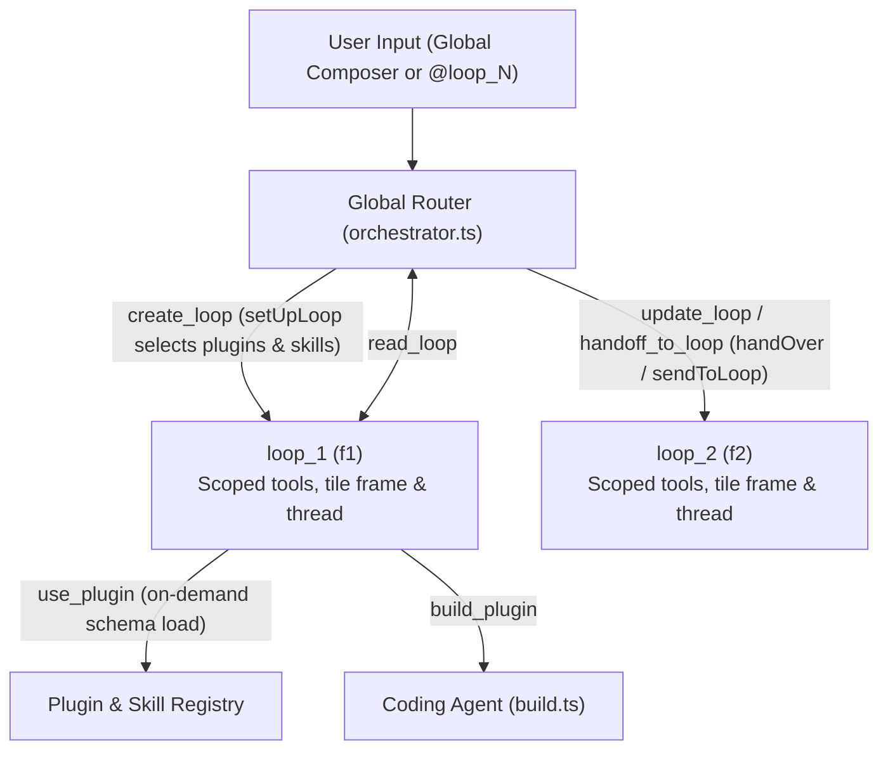
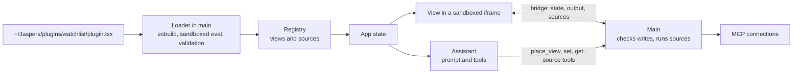

# How it works

Jaspers Terminal is an Electron desktop application for public-market research that runs with local, open-weight, or cloud language models (including Ollama, vLLM, `llama.cpp`, LM Studio, OpenRouter, Groq, Jaspers One, and direct cloud providers). The main process owns the single state tree, runs the orchestrator and numbered Grid Loop subagents, connects to MCP servers, records fetched data into a local SQLite store, and builds plugins through its built-in coding agent. Windows render what main pushes to them and send actions back; sandboxed plugins fill the grid.

## Prompt and context management

Rather than appending raw tool responses, multi-thousand-row datasets, and full filing text directly to the conversation history, the harness bounds prompt size through three mechanisms:

1. **Bounded Zod `state` and `output` contracts (`STATE_MAX` & `OUTPUT_MAX`):**
   Every grid view declares Zod schemas for `state` (what the assistant writes via `place_view` or `set`) and `output` (what the view reports back via `usePublish(panel, output)`). In every round's prompt (`src/shared/agent/prompt.ts`), each panel's serialized `state` is bounded to 2 KB (`STATE_MAX = 2048`) and its `output` is bounded to **4 KB** (`OUTPUT_MAX = 4096`, also enforced by `setPanelOutput` in `src/main/actions.ts`). State mutations are coerced and validated against the view's Zod schema (`coerceViewState` and `setPanelStateChecked`), returning schema validation errors instead of writing invalid UI state.
   When a view renders long documents or tables (such as an SEC filing, earnings transcript, or full series), it publishes up to 200,000 characters (`PANEL_TEXT_MAX = 200_000`) via `usePublishText(panel, text)` to `panels/<id>/text`. That text is not injected into the round prompt; the assistant reads it on demand in paginated slices via `get { path: "panels/<id>/text", offset }` (`src/main/agent/tools/state.ts`).

2. **SQLite context offloading (`~/Jaspers/data/jaspers.db`):**
   Every source invocation is recorded by a dedicated store process (`src/store/db.ts`) into `~/Jaspers/data/jaspers.db` (opened in WAL mode with `0600` file permissions):
   - `runs` — one row per source execution (`id`, `source`, `args`, `args_hash`, `workspace`, `fetched_at`, `row_count`, `meta`, `text`, `error`).
   - `run_rows` — each returned object stored as an indexed JSON row (`run_id`, `idx`, `data`), queryable with `json_extract(data, '$.field')` so the model can filter, join, and aggregate across providers and sessions.
   - `docs` — an external-content FTS5 full-text index (`create virtual table docs using fts5(text, content='runs', content_rowid='id')`) over `runs.text`, supporting phrase and BM25 search over filings and transcripts without storing duplicate text.
   - `watched` — rolling SHA-256 observations (`task`, `at`, `hash`, `text`, retaining the latest 20 per task) used by scheduled SQLite delta watches (see [Skills](skills.md)).
   - `threads`, `exchanges`, `usage`, and `notifications` — persistent conversation threads (`<workspace>`, `<workspace>/<loop>`, `build/<id>`), user-visible transcripts, daily token accounting by origin, and the notification inbox.

   The assistant queries `~/Jaspers/data/jaspers.db` through the read-only `query` tool (`src/shared/data/store.ts`), which enforces both a read-only SQLite connection (`new DatabaseSync(file, { readOnly: true })`) and `checkQuery` validation (single `SELECT` or `WITH … SELECT` statement only, default `QUERY_LIMIT_DEFAULT = 500` rows, max `QUERY_LIMIT_MAX = 2000` rows).
   Alongside `jaspers.db`, the store process also manages **Prism DB v0** (`~/Jaspers/data/memory.prism`, `packages/prism-db` `0.2.0`), an embedded single-file hybrid retrieval database (`src/store/prism.ts`). Everything that passes through the harness — chat messages (`message`), source outputs (`tool_output`), memories and standing instructions (`note`), Pro mode commands (`command`), fetched web pages (`web`), and skill files (`file`) — is chunked and indexed in the background with a local `bge-small-en-v1.5` embedder and code-aware BM25 (`tokenizer: 'v2'`). The assistant searches `memory.prism` through the `search` tool (exact single-pass hybrid vector + BM25 + recency with typed column filters and stage-2 cross-encoder reranking, or latest-N ordered listing) and through `SELECT … FROM documents` in `query`.

3. **Context set-aside (`read_again`) and portable threads (`portable`):**
   Every conversation thread is kept whole on disk, while `src/shared/agent/aside.ts` bounds the active wire prompt: once tool outputs in a request exceed `WHOLE_MAX` (`60,000` characters) or belong to earlier requests, long outputs (`LARGE = 1500` characters) are replaced in the prompt with a short header and a note naming `read_again "<callId>"`. The model can retrieve any full output on demand via `read_again` rather than resending prior tool payloads on every turn. When you switch between cloud and local models in **Settings > Language model**, `portable` (`src/shared/agent/history.ts`) strips provider-specific replay payloads (such as thinking blocks) while preserving every user message, assistant reply, and tool call.

## Concurrent Grid Loop subagents (`loop_1`, `loop_2`, …)

Jaspers Terminal separates workspace routing from per-tile execution (`src/main/agent/orchestrator.ts`, `src/main/agent/router.ts`, `src/main/agent/loop.ts`, and `src/shared/loops/loops.ts`):



- **Global router (`src/main/agent/orchestrator.ts` & `src/main/agent/router.ts`):** The assistant in the global composer oversees the workspace, inspects loops, panels, and the SQLite store (`read_loop`, `get`, `query`) to answer questions and compare work across tiles, and manages the workspace layout, settings, keys, plugin installations, skills, and scheduled tasks. It has no plugin source-fetching or view-mutation tools of its own and knows installed plugins by name only.
- **Starting a loop (`create_loop` & `setUpLoop`):** For any request that requires data, views, or research, the router calls `create_loop` (`src/main/agent/router.ts`) with a one-line `desc` and a `brief`. Before creating the tile, `setUpLoop` (`src/main/agent/setup.ts`) runs a dedicated one-round catalog selection call (`choose_for_work`) against the full installed catalog to select only the plugins and skills that piece of work needs. For interactive requests, the user is prompted (`Start` / `No`) with `desc` and the chosen plugins before the frame is placed.
- **Handing off to an existing loop (`update_loop` / `handoff_to_loop` via `handOver` and `sendToLoop`):** Follow-up requests for existing work are routed with `update_loop` (marked `handoff: true` in `src/main/agent/router.ts`, conceptually `handoff_to_loop`). Interactive handoffs dispatch asynchronously via `handOver` (`src/main/agent/loop.ts`) so the global composer closes immediately while the loop works in its own tile; scheduled-task handoffs await completion via `sendToLoop` so the task records the loop's final answer. Users can also target a loop directly by typing in its tile's command line or prefixing `@loop_3` in the global composer.
- **Numbered frames and isolated sub-grids (`f1` → `loop_1`):** Each loop receives a monotonic workspace ID (`f1`, `f2`, … displayed and addressed as `loop_1`, `loop_2`, … via `loopName` in `src/shared/loops/loops.ts`) that is never reused. Its frame sits on the window's cells, and the views it places (`place_view`) are laid out inside that frame on a sub-grid of the loop's own (`parent`), moving, resizing, minimizing, and maximizing as one unit. Multiple loops run concurrently across tiles and monitors, each with its own `AbortController` and Stop button.
- **Inspecting, expanding, and managing loops (`read_loop`, `use_plugin`, `close_loop`, `reopen_loop`, `delete_loop`):**
  - `read_loop` (`src/main/agent/tools/loops.ts`) reads a loop's current status (`working`, `asking`, `done`, `failed`), its views and their outputs, and its last 5 exchanges (`READ_EXCHANGES = 5`).
  - `use_plugin` (`src/main/agent/tools/loops.ts`) allows a loop subagent to load the full view, source, connection, and skill definitions of another installed plugin on demand and persist that plugin in its loop record.
  - `close_loop` stops any active run and moves the loop's frame, views, and conversation into `closedLoops` (**Settings > View loops**); `reopen_loop` restores it to the grid with its conversation intact; `delete_loop` permanently deletes the loop and forgets its chat (`forgetChat`).

## The Coding Agent (`build_plugin`) lifecycle

When a loop needs a data source, custom view, document generator, or MCP connection that isn't installed, it searches [Jaspers Hub](https://hub.jsprai.com) (`find_plugin`) first. When nothing on Hub fits, it calls `build_plugin` (`src/main/agent/build.ts`), launching the builder agent loop (`runBuild`):

1. **Prompt assembly (`reference.ts` & `prompt.ts`):**
   `runBuild` starts a quiet agent loop (`BUILD_ROUNDS = 40`, `maxTokens: 16_000`) on a dedicated persistent chat thread (`build/<id>`). Its system prompt (`builderSystem` in `src/shared/agent/build/prompt.ts`) embeds `REFERENCE` (`src/main/agent/build/reference.ts`), which imports [`docs/sdk-reference.md`](sdk-reference.md), [`docs/writing-a-plugin.md`](writing-a-plugin.md), `packages/sdk/src/context.ts`, `packages/sdk/src/llm.ts`, and the four starter templates in [`docs/templates/`](templates/README.md) (`feed`, `feed-table`, `document`, `connection`) via Vite `?raw`.
2. **Staging in `~/Jaspers/.build/<id>` (`folder.ts`):**
   For a new plugin ID, `openFolder` (`src/main/agent/build/folder.ts`) opens a staging directory at `~/Jaspers/.build/<id>`, outside the watched `~/Jaspers/plugins/` folder so unapproved code is never built or executed. The builder inspects any previously built plugin for the same service (`list_files`, `read_file`) or fetches API docs (`search_web`, `fetch_page` with `.md` and `/llms.txt` fallbacks), then writes the plugin's shell (`package.json`, `plugin.tsx`, and any view/helper files) with `write_file`.
3. **Security envelope approval (`install_plugin` & `.jaspers-build.json`):**
   The builder calls `install_plugin` (`src/main/agent/build/install.ts`) with a one-line `purpose` and every resource the plugin will reach: `hosts`, `capabilities` (`files`, `llm`, `tools`, `state`, `skills`), `secrets`, `connections` (`https://` MCP URLs only), `packages`, and `frames`. The user is shown this **envelope** alongside the complete staged files (`trustQuestion`). On **Build it**, the app writes `.jaspers-build.json`, installs any declared npm packages (`installPackages` with install scripts disabled and native binaries rejected), and moves (`landFolder`) `~/Jaspers/.build/<id>` into `~/Jaspers/plugins/<id>`.
4. **Dual esbuild compilation & envelope enforcement:**
   The plugin loader bundles `~/Jaspers/plugins/<id>` twice with esbuild (once for the view iframe and once to evaluate definitions in a restricted Node `vm` sandbox with a 2-second timeout) and verifies that declared hosts, capabilities, secrets, connections, packages, and frames stay within `.jaspers-build.json`. Any later edit that widens the envelope refuses to build until the user approves the delta (`widenQuestion`).
5. **Iterative compilation and verification (`edit_file`, `check_plugin`, & `run_source`):**
   The builder fills in each source and helper one piece per round with `edit_file`, calls `check_plugin` (`waitForBuild` in `src/main/agent/build/check.ts`) to await the watcher's rebuild and read any TypeScript, bundler, or schema errors, updates the files if diagnostics are reported, and executes `run_source` with a test argument before returning the finished plugin summary to the calling loop. If a build stops early for any reason, its files and `build/<id>` conversation stay intact so calling `build_plugin` with the same `id` resumes where it left off. See [Asking the assistant for a plugin](asking-for-a-plugin.md).

## The app

- **One state tree, owned by main.** The Electron main process holds the app's state and is the only thing that writes it. After each change it pushes the whole tree to every window. The interface never edits state; it sends actions to main.
- **The assistant runs in main.** Each request calls the model with what is installed in its prompt, and the grid, the work on it, the focused element's state, the time, and the scheduled tasks alongside each turn. It runs the tools the model asks for and repeats until the model answers. The assistant in the box above the composer (and in the docked Central tile) oversees the workspace, routes work, and runs the app: it calls no plugin sources itself, but inspects loops, panels, tasks, and the SQLite store (`read_loop`, `get`, `query`) to reason over what is going on across the workspace and answer questions in words. It also answers about the app (the layout, the work on the grid, tasks, settings, plugins, keys, skills), arranges the grid, changes a setting when you ask (theme, open at login, grid size, the task budget, skills on or off, reconnecting or removing a plugin, the model and the voice and search providers; it asks before removing a plugin or switching a provider, and never touches Pro mode or Eye), and for anything that needs new plugin data, or is to be placed or changed in a tile, it starts a piece of work or hands the request to the work it is about. When it only starts or hands over work, its part ends there: the box above the composer closes, and the work answers in its own tile. It knows the installed plugins by name only; a new piece of work is set up by a call of its own that reads everything installed and chooses the plugins and skills the work needs. Before the work starts you are asked, shown what the work is and which plugins it uses, and nothing is made until you press Start; when it cannot tell what a request means, or whether it is for the chat, for work that exists, or for new work, it asks. A request starts as it is sent: you can send another while one is still working, and each runs beside the others with its own trail and its own Stop, which ends it, keeping what it had done so far. Requests in flight do not see each other's work until one has ended; each sees the grid as it is. A question from one of them waits its turn behind a question already on screen, and says which request it came from. A scheduled task's run never holds up yours. The chat keeps every exchange of a workspace's conversation, across restarts, and scrolling up reads back through it. The model is sent less: the last three exchanges and the new request, with what those exchanges' tools answered at length as notes it can read again. What it works from is scoped to the workspace and restored across app sessions; switching the model goes on with the same conversation, and `/new` starts it over.
- **Every piece of work has a tile and an assistant of its own.** Each element on a window's grid but the docked chat is the tile of a piece of work, named in its bar, with a conversation of its own that is kept across restarts. The views the work shows are laid out inside the tile, under its command line, on cells of the tile's own, drawn fitted to what is there: one view fills the tile, and a dashboard of ten is still one tile, which moves, resizes, minimizes, and maximizes as one. A view inside is resized by hand by an edge it turns to another view, on the tile's own cells: it stops against its neighbor, as a tile of a window does, so one is made smaller before the one beside it is made larger. The sides it shares with the tile resize the tile. A line typed in the command line at the top of the tile goes to that work's own run of the assistant: it is told of its own tile first and of the plugins its work uses, learning of another when it needs one, changes only its own views, places a new view inside its tile, and asks its questions and answers in the box, under the line. The box is folded to the line by default: a small label in the tile's bar says how the loop stands, working with what it is doing now, done, failed, or asking, and pressing it opens the box under the line. In a tile with no view yet, a run opens the box itself, so what the work is doing is what the tile shows, and the first view to load folds it. Open, a deep research loop shows the whole conversation; any other shows only the steps and the reply of its last request: its conversation is kept, and never opened. What it found is said there, briefly unless it is a deep research loop: it has no note to put its own words on the grid in, and the views under the line are for what the plugins show. It is sent its whole conversation, not the last three exchanges: every word of it, with what earlier requests found as notes that say how to read it again, so a small request in a tile does not carry everything the work ever fetched. Nothing is dropped from the conversation that is kept. One run at a time: a message sent while the work is at it joins that run, read with what it was just doing, and one sent as the reply is being written starts the next. The label in a tile's bar is that mark too, while its work is working or asking. Its minimize button leaves the tile as its bar, where it stands, with the cells under it free for others; what it showed is kept, a question waits, and the same button or a double click on the bar brings it back where it was, or to the nearest free cells. The bar ends in a menu, which a minimized tile keeps: what may be done (stop what the work is doing, close the loop, or delete it, which ends it and forgets its conversation), then what the work's assistant was told of, with each connection and what it is doing, and the work's timeline. Work the assistant starts from the global box gets a tile at once, half a window unless the request says where, which shows what its own assistant is doing until that one's first view loads into it and folds the box. The box above the composer is one conversation for the workspace; it places no view itself, and a view placed by hand becomes a piece of work of its own, in a tile it fills. A message typed there that starts with a loop's name, `@loop_3`, goes straight to that loop, as if typed in its tile.
- **A piece of work is a loop, and loops are numbered.** Each is named by the number its workspace gave it when it was made, loop_1, loop_2, and so on, never by what it does; a number is never given twice, so a loop keeps it through closing and reopening. Its bar reads `loop_3 · what it is`, and that is how you name it to the assistant ("send this to loop_3", "@loop_3 use 30 days"). The cross on its bar closes it: its tile goes with every view in it and what it is doing stops, but the loop is kept, views and conversation. **Settings > View loops** opens the list of every loop of the workspace on screen, open and closed, the one changed last first, with when it was created, closed, and reopened. Reopen puts a closed loop back where it was, or on the nearest free cells, and its assistant carries on with the conversation; Delete forgets it for good. The assistant can close and reopen loops too when you ask.
- **Tasks run in main too.** One timer runs each task at its time: one tool call made directly, like refreshing a view, or a request to the assistant, whose reply joins the workspace's conversation. Work such a request starts stays within the task's limits: it is told it runs for a task, it asks for no key, a question it has to ask waits ten minutes and no longer, and it counts against the daily budget. The task's run lasts until that work is done, and what the task says is what the work said.
- **Connections** are MCP servers, over stdio or streamable HTTP. A plugin declares them in its `plugin.tsx`, or you add one in Settings and the app writes that plugin for you. Main keeps one client per connection. Keys, OAuth tokens, and the Jaspers sign-in's tokens never leave main; a server that signs its users in through Jaspers connects on that sign-in.
- **A server's own views.** An MCP server can ship a page for a tool's answer (MCP Apps). Main reads the page from the server and serves it on a scheme of its own, one origin per connection, with the policy the page declared. The built-in `core/app` view hosts it in a sandboxed iframe and passes what the page asks for to main, which checks each request against the panel it came from.
- **The store** is one SQLite file, `~/Jaspers/data/jaspers.db`. Every source run is recorded there with its arguments, its workspace, and the time, and the assistant reads it back with a read-only `query` tool. Each chat is kept there too, an exchange with what its run did and, when it failed, why. It runs in a process of its own, since SQLite is synchronous and main is what pushes state to the windows.
- **Plugins** are folders in `~/Jaspers/plugins/`, put there by hand or installed from Settings. Main builds each one, registers its views and sources, and renders its views in sandboxed iframes. A plugin with code of its own runs it in a separate process, reaching the app only through capabilities it declares. A plugin's view that is waiting on you, for a key the plugin declares or a sign-in to one of its connections, asks for it in its own element.
- **Skills** are folders with a `SKILL.md`, in `~/Jaspers/skills/` or a plugin's `skills/` folder, in the [Agent Skills](https://agentskills.io) format. The assistant's prompt lists each skill's name and description. When a request fits one, or the user types `/name`, the assistant loads that skill's instructions with a tool, and reads the skill's other files with another. A plugin's own model loads them the same way through its `skills` capability. See [Skills](skills.md).

## How a plugin connects to the app

A plugin adds views and data sources.

- A **view** is a React component that lives in a grid element. The assistant places it, changes what it shows by writing its state, and reads back what it shows.
- A **source** is a named data call, usually one tool on an MCP server. Views and the assistant both run sources.



1. **Discovery.** The app looks for folders with a `plugin.tsx` in `~/Jaspers/plugins/` (or `$JASPERS_HOME/plugins/`), whether you put it there or installed it. The folder name is the plugin id.
2. **Build.** Main bundles the folder with esbuild twice: once for the view's iframe, and once to read the definitions. Everything the plugin imports is bundled in, found in the plugin's own `node_modules`, except what the app provides: `react`, `react-dom`, `zod`, and `@jaspers-ai/sdk`.
3. **Definitions.** The definitions run once in a sandbox with no file system, no network, no Node globals, and a 2 second limit. React is a stub there, so components never run in main.
4. **Registration.** Main checks the definition, then registers its connections, sources, and views as `<plugin>/<name>`, like `watchlist/quotes`.
5. **What the assistant sees.** A piece of work's assistant is told each of its plugins' views with the state keys it takes, and each source with its connection's status; the one in the global box is told what each view is, and the sources. Either calls sources through `run_source { source, input }` and asks `describe_source` for a full input schema when needed. For the watchlist below:

   ```text
   - watchlist/watchlist: Watchlist. Renders watchlist/quotes. state: { tickers }
   - watchlist/quotes: Quotes for ticker symbols: name, price, and the day's change as a fraction. — takes tickers [connection watchlist/server: ready]
   ```

   A piece of work's assistant is told where its tile is, how the views inside it are laid out, and for each of them the view's `instructions`, state, and output. The one in the global box is told each tile with the views inside it, and which tile is focused.

6. **Placing and driving.** A piece of work's assistant calls `place_view { view: "watchlist/watchlist", state: { tickers: ["AAPL"] } }`, which puts the view inside its tile, changes the element with `set panels/e1/state/tickers ["MSFT"]`, and reads it with `get panels/e1/output`. Main checks every state write against the view's schema and rejects invalid ones with the reason.
7. **Rendering.** Each plugin view gets its own sandboxed iframe with no network and no reach into the app. A plugin can declare sites its views may show in a frame, as the TradingView chart does. The app supplies React, zod, and the SDK. The view talks to the app only through the SDK hooks, which pass messages to main.
8. **Sources run through main.** Main calls an MCP connection or delegates a function source to its plugin host, keeps the rows, and hands them to the view. Two runs with the same arguments within 60 seconds share one call. Keys never reach a plugin.
9. **Hot reload.** Saving any file in a plugin folder in `~/Jaspers/plugins` rebuilds the plugin and remounts its views, and each element keeps its state and output. A failed build keeps the last good version running and reports the error.

## Project layout

```
src/main/agent/    The assistant's loop and its helpers under utils/, orchestrator.ts, loop.ts, router.ts, setup.ts, its threads and memory, the tool families under tools/, the plugin builder (build.ts and build/), and the web under web/
src/main/loops/    Loop records in the state tree
src/main/tasks/    Scheduled tasks and SQLite delta watch execution (tasks.ts), paired with clock-rule.ts, market-calendar.ts, and delta.ts in src/shared/tasks/
src/main/skills/   Agent Skills discovery, editing, installation, and assistant-authored skills
src/main/llm/      Provider request protocols and stream readers
src/main/plugins/  Plugins, their hosts and capabilities, installs, connections, and MCP Apps
src/main/hub/      Jaspers Hub: the directory's listings, and publishing a plugin or skill of the user's own
src/main/eye/      Opt-in live feedback sharing and one-shot feedback
src/main/          Main process: the state tree and its actions at the root, a folder per area beside them
src/preload/       The bridge between the interface and main
src/renderer/      Interface: React, TypeScript, Tailwind CSS v4
src/plugin-host/   Isolated utility process running plugin backend sources and jobs
src/host-runtime/  What a plugin view's iframe loads (jaspers-host://runtime/): React, zod, the SDK
src/store/         The store process (db.ts): the SQLite file (~/Jaspers/data/jaspers.db) every source run is kept in
src/shared/        Types and pure logic shared across processes, a folder per area
packages/sdk/      @jaspers-ai/sdk: what views and plugins are written against
scripts/           Build scripts: the plugin view runtime, the SDK package
electron-builder.yml  Packaging for `npm run dist`
```

Built with Electron and electron-vite. Contributor commands and rules live in [CLAUDE.md](../CLAUDE.md); implementation constraints are in [Development](development.md).

## Further reading

- [Getting started](getting-started.md) covers local and open-weight LLM setup, workspace model switching, and per-task model pinning.
- [Asking the assistant for a plugin](asking-for-a-plugin.md) covers the `build_plugin` coding agent and the `.jaspers-build.json` security envelope.
- [Connections and data](connections-and-data.md) covers adding a server, the built-in views, and the store.
- [Skills](skills.md) covers Agent Skills (`SKILL.md`), NYSE market-calendar scheduling, and SQLite delta watches.
- [Pro mode](pro-mode.md) covers sandboxed local shell, Python, R, and CLI execution in `~/Jaspers/shell`.
- [Writing a plugin](writing-a-plugin.md) builds one from scratch.
- [SDK reference](sdk-reference.md) lists what `@jaspers-ai/sdk` exports.
